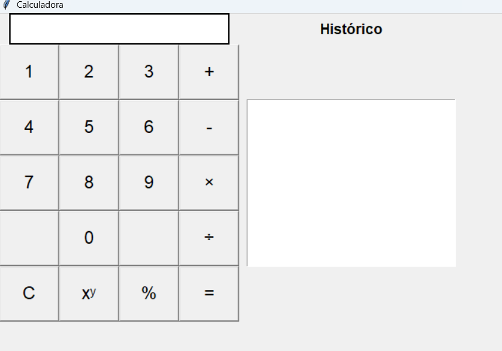

# Calculadora Python
Minha primeira calculadora gráfica, desenvolvida em Python usando Tkinter.

## Demonstração

## O que ela faz?
* Soma
* Subtracao
* Multiplicacao
* Divisao
* Potenciacao
* Porcentagem
* Historico dos calculos
  
## Tecnologias
- Python
- Tkinter

## Como executar
1. Tenha o Python instalado.
2. Baixe o arquivo `calculadora.py`.
3. Execute pelo PyCharm ou IDLE.

Esse foi meu primeiro projeto enquanto aprendia Python. Ainda pretendo adicionar novas funções e melhorar a calculadora conforme for aprendendo.
